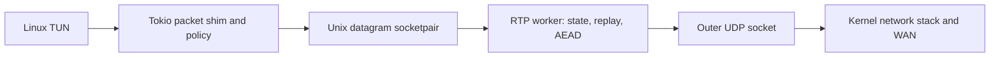

# RTP packet-path efficiency and scaling plan

Status: implementation started on 2026-10-28 at the user’s request. The measured
throughput reference is merged into this branch. Deployment and later phases
remain subject to the acceptance gates below. Follow-up to the measured throughput fixes in
[PR #155](https://github.com/simophin/cpxy-ng/pull/155).

## Recommendation

Reduce kernel crossings, copying and packet handoffs before introducing
parallel flow processing. Keep one lifecycle owner and the existing wire format.
Make the first implementation a simple Linux `recvmmsg`/`sendmmsg` batching
experiment. Measure its throughput, CPU, drops and latency before starting any
io_uring implementation. Only pursue io_uring if the measured remaining cost
justifies it. A router-specific experiment can separately remove the datagram
socketpair hop while preserving packet policy and split DNS. Measure each
independently.

Do not add a general crypto pool, per-flow allocations, new port mappings or
more threads by default. The tested tr3600 already uses both of its physical
cores. Additional concurrency is a conditional later project for hardware with
spare CPU or an endpoint serving many clients, not an assumed speedup for this
router. This plan supersedes an initial hypothesis that the current router was
limited to utilizing one core.

## Evidence and its limits

The 2026-10-28 live investigation used alternating downloads on tr3600 through
hh-hk's old CPXY HTTP transport and RTP, with a private HTTP origin on hh-hk.
The [report and full evidence in the fix branch](https://github.com/simophin/cpxy-ng/blob/fix/rtp-router-throughput/docs/rtp-router-throughput-results.md)
record sizes, counters, binaries, failed samples excluded and rollback details.

| Observation | Implication |
| --- | --- |
| Original four-stream RTP approximately 62 Mbit/s; current fix approximately 116–131; concurrent proxy approximately 300–320 | The small fix recovers capacity, but transport overhead still leaves a large gap. |
| Longer four-stream RTP windows approximately 132 and 153 Mbit/s; nearby proxy window approximately 328 | Investigate sustained packet-processing cost, rather than declaring the short test a speed ceiling. |
| Both 2 GHz Cortex-A53 cores busy: approximately 92% and 87% | There is little spare router CPU for a pool of additional workers. |
| RTP worker approximately 63% of one core; two Tokio shim threads approximately 41% combined | A process-wide CPU value of 100% does not mean one packet worker saturated a core. |
| System-wide CPU approximately 27% user, 55% system, 8% IRQ/softirq | Kernel/syscall and packet-handoff work are strong profiling candidates; crypto-only parallelism is not justified yet. |
| 22,698 UDPv6 receive-buffer errors in a 20.95-second loaded sample, despite larger buffers | Buffering alone does not fix sustained overload. Attribute drops per socket and queue before further tuning. |
| Idle ping average 39.4 ms; loaded average 79.4, maximum 159.6, 18/20 replies | Throughput gains must be judged alongside overload loss and latency. |
| Both inner MTUs 1200, observed MSS 1160, full-size pings pass; fragment-failure counter unchanged | Do not make MTU changes part of this optimization. |

These are observations on a shared live router, not a CPU flamegraph or proof
that every system-time cycle belongs to RTP. Forwarded LAN/Wi-Fi acceptance is
still needed. The TCP-terminating proxy and a packet VPN have different
congestion-control behavior; proxy bandwidth is a practical reference, not a
guaranteed target that an optimized packet VPN must match. The earlier RTP
version has not been recreated on an identical path.

## Current ownership and packet path

The router's `rtp-mobile::Prepared::start_inner` starts two Tokio `rtp-engine`
runtime threads and one `rtp-worker`. The shim runs outbound/inbound tasks and
handles DNS/policy. Other threads manage application lifecycle and supporting
services. Linux routing, NAT, IRQs and softirqs also consume CPU.



The reverse direction traverses the same stages in reverse. Even with threads
scheduled on different cores, every packet crosses the socketpair and TUN
boundary, and packet work can serialize across these stages. The endpoint has
one TUN/UDP dispatcher shared by allocations and a separate HTTP/firewall owner.
Its table lock is another potential multi-client bottleneck; measurements from
one client do not establish its server-wide scaling behavior.

## Changes in order

### 1. Establish a reproducible CPU and drop profile

Use the fixed binaries as the reference. Collect per-core/per-thread CPU,
syscall rates, context switches, kernel network/softirq time and receive-buffer
overflows. Add aggregate per-allocation counters for socket drops, rejected
packets, queue depth/high-water mark, oldest age and backpressure, with generation
labels. Use sampled profiling where supported; avoid per-packet logging or
packet payload/credential collection. Distinguish TUN, socketpair and UDP queue
pressure instead of inferring all drops from host-wide UDP counters.

Run one/four/eight streams in both directions and bidirectionally, idle/loaded
latency, and at least two clients for the endpoint. Include a bounded UDP rate
ladder to locate overload without letting a sender indefinitely saturate the
live connection. Benchmark controlled origin delivery before public downloads.
Repeat adjacent reference/change/reference windows at quiet and busy times.

Record IRQ affinity/RPS and offload settings but keep them fixed initially.
The measured router had Ethernet IRQs on core 0 and eth0 receive RPS targeting
core 1; moving work to another core may merely move the bottleneck. Do not
enable flow offload that could bypass VPN policy.

### 2. Batch Linux UDP I/O and reuse packet storage

Introduce a Linux transport-I/O adapter with a portable fallback. Use
nonblocking `recvmmsg` and `sendmmsg` for bounded batches, testing batch budgets
16/32/64. Poll on readiness when idle and flush available work promptly; do not
wait for a full batch. Reuse descriptor arrays, message headers and bounded
packet storage to reduce allocations and copies. Keep lifecycle and packet
state in their current single owners.

Both [recvmmsg](https://man7.org/linux/man-pages/man2/recvmmsg.2.html) and
[sendmmsg](https://man7.org/linux/man-pages/man2/sendmmsg.2.html) process multiple
messages per syscall. Actual gains depend on traffic and kernel cost and must
be measured. Musl/glibc structure layouts, returned message lengths and ancillary
data need dedicated adapter tests. No new public configuration should be needed.

Requirements:

- Preserve one authenticated RTP frame per UDP datagram and the 1200-byte inner
  limit. Detect truncation and retain source-tuple checks per received message.
- On partial sends, retire only the successfully submitted prefix and retain
  the exact unsent ciphertext for retry. A reserved packet number is never
  reused for different plaintext or headers. Intentionally discarded frames
  leave number gaps; they must not roll counters back.
- Keep bounded per-client budgets and fair scheduling so a bulk download
  cannot starve control, another client, repair or rotation.
- Keep authentication before replay commit and all path/routing effects.
  Batching must not bypass source-address policy, DNS policy or fail-closed guards.
- Do not treat `readv`/`writev` on TUN as multi-packet I/O; packet boundaries are
  different from UDP message vectors. Do not introduce GSO/GRO or new TUN
  offload framing in the same change.

Expected impact: fewer UDP syscalls per packet, lower system CPU and fewer burst
drops; moderate implementation cost with a small platform adapter. It may help
both single and multiple streams without flow-management complexity. A 2x gain
or proxy-equivalent speed is not promised.

### 2a. Compare io_uring against the simpler batching adapter

**Prerequisite: finish and measure step 2 first.** Do not implement io_uring in
parallel with the initial mmsg batching change or bundle both into one PR.
Publish adjacent reference/mmsg/reference results for throughput, total and
per-core CPU, drops, queue pressure and idle/loaded latency. If the simple path
meets the practical performance goal, stop there. Start an io_uring prototype
only if the measurements show a meaningful remaining I/O submission/wakeup cost
that it could plausibly reduce; kernel copying or network-stack cost alone does
not establish that. Record that decision in the follow-up PR before adding the
more complex backend.

`io_uring` is a credible alternative for UDP I/O scheduling, without distributing
flows or changing lifecycle ownership. On the actual router (Linux 6.12.94),
`kernel.io_uring_disabled` was 0 and a temporary static probe successfully created
and closed a two-entry ring with no polling thread. The probe and ring were
removed. This establishes basic availability, not UDP multishot, TUN-operation
support, feature completeness or a performance benefit.

An experiment should compare the readiness/mmsg baseline with a single-issuer
ring, bounded provided buffers, multishot `recvmsg` for UDP, and batched send
submissions. Preserve the current logical owner for allocation, path and replay
state. Do not rewrite the DNS/Tokio runtime or introduce concurrent flow owners
to use it. The same Linux adapter boundary should permit a startup-probed
fallback to mmsg on unsupported kernels/platforms.

[Multishot recvmsg](https://man7.org/linux/man-pages/man3/io_uring_prep_recvmsg_multishot.3.html)
has been available since Linux 6.0. It posts multiple completions for one receive
submission and requires provided-buffer selection. The source address and
ancillary metadata must be decoded from its output layout before the existing
peer validation. Check `IORING_CQE_F_MORE` on every completion and rearm when
the request ends, including buffer exhaustion. Keep a buffer owned until all
AEAD/packet processing and any pending send using it finish; replenish the pool
explicitly. Test truncated datagrams, completion overflow, buffer exhaustion,
cancel/completion races and stale generation completions during rotation/stop.

For TUN, separately probe/read-test the actual operation and completion behavior
inside the namespace fixture; socket multishot support does not establish that
the same API works on TUN. Merely replacing calls with ring operations leaves
the current socketpair hop, ordinary packet copies, encryption, NAT and kernel
network processing in place. Attribute any gain to fewer submissions/wakeups,
not an assumed bypass of the network stack.

Start without SQPOLL or other busy-polling. Dedicating CPU to polling could
worsen contention or idle power on this already busy dual-core router. Account
for kernel/helper-thread CPU in the same per-core measurements as application
threads; do not call shifting work out of the process a CPU saving.

Treat zero-copy as a separate later experiment. The kernel's classic
[MSG_ZEROCOPY guidance](https://kernel.org/doc/html/v6.6/networking/msg_zerocopy.html)
explains that page accounting/completion overhead generally makes it useful for
writes above roughly 10 KB. That is not a measured break-even for io_uring
`SEND_ZC`, but it argues against assuming a win for our approximately 1.2 KB
datagrams. Native io_uring
[zero-copy receive](https://docs.kernel.org/networking/iou-zcrx.html) is another
feature with specific NIC queue/header-split/steering requirements; do not assume
that basic ring availability makes it usable for this router's encrypted UDP
path or budget a firmware/NIC change into the first implementation.

Expected impact: possible lower per-packet syscall/submission overhead and more
efficient buffer reuse, with no new flow-management model. Maintenance cost is
higher than mmsg because buffer ownership, asynchronous completions, cancellation
and kernel-feature fallback are explicit. Retain it only if it beats mmsg by the
same acceptance gates below. Do not maintain two permanent optimized Linux
backends for a noise-level difference.

### 3. Remove the router's extra packet handoff

After profiling and batching, prototype a Linux router packet adapter that
executes the existing pure packet classification directly in the transport
worker, using the TUN descriptor instead of a datagram socketpair. Extract and
reuse the current classifier; do not maintain a second policy implementation.

Keep DNS resolution asynchronous in the existing runtime. Recognized DNS
queries leave the hot path through a bounded request queue; DNS replies and
resolver tunnel queries return through a bounded injection queue with an
explicit wakeup descriptor. Ordinary TCP/UDP packets take the direct path.
Reject/drop/local-reply cases must have identical behavior, including regional
IPv6 policy, QUIC/DoT refusal and local/private DNS handling. Do not move a
blocking resolver call or a waiting channel receive into the packet loop.

Initially make this opt-in for OpenWrt/Linux only and retain the portable
mobile shim. The platform still supplies/protects sockets and owns TUN/firewall
lifecycle; the transport core must not start choosing host routes or executing
commands. Keep the packet-I/O abstraction and cancellation behavior testable.
If the adapter becomes a platform-specific policy fork, stop and revise the
design before making it default.

Expected impact: remove two socketpair syscalls, extra kernel buffering/copies
and cross-thread wakeups from each ordinary one-way packet traversal. This is
an opportunity to lower CPU and jitter, not a measured gain yet. It carries more
integration risk than batching: DNS injection, wakeups, cancellation, fairness
and nonblocking TUN backpressure need explicit ownership and tests. It may also
concentrate work in the transport thread; reprofile that thread before assuming
the direct path scales better. Prototype and compare before replacing the shim.

### 4. Consider additional workers only after remeasurement

| Option | Likely benefit | Cost and decision |
| --- | --- | --- |
| Add more Tokio threads | Little reason to expect improvement on this dual-core router | Do not do this by default; the existing two runtime workers already run shim work. |
| Endpoint worker shards by client/allocation owner | More aggregate capacity for many clients on a server with spare cores | Consider after multi-client profiling. Preserve one owner across each client's active/draining allocations and centralize admission/address ownership. |
| Router directional pipeline or bounded AEAD workers | Could help a larger router if one stage becomes CPU-bound after copy/syscall reductions | Conditional prototype only; queues, wakeups and replay/counter coordination may outweigh the benefit. |
| Multiqueue TUN plus flow-affine packet workers | Potential parallel packet delivery on larger hosts | Later project with explicit steering and lifecycle design; not a flag-only speedup. |
| Multiple concurrent allocations or per-flow tunnel sessions | More independent transport/state owners | Defer: current downstream routing selects one active owner per client. Concurrent ownership changes protocol/lifecycle semantics and operational complexity. |

Linux [multiqueue TUN](https://docs.kernel.org/networking/tuntap.html) requires
multiple queue descriptors attached with `IFF_MULTI_QUEUE`; duplicating the
existing descriptor is not enough. It does not automatically split an encrypted
outer UDP tuple by inner flow or make replay state independent.

Any future parallel AEAD prototype must keep a single authority for packet
number reservation and authenticated replay acceptance per allocation/direction.
Workers may verify/decrypt immutable jobs, but unauthenticated input cannot
advance replay/path state. Tag queued work with lifecycle generations and
discard stale completions after repair, handover, shutdown or worker failure.
Bound outstanding work below the replay/reordering tolerance and preserve
per-flow order where required. Avoid a coarse lock around the entire existing
loop, which adds complexity without parallelizing it. These requirements are
why this is a separate, gated design rather than the first optimization.

## Acceptance gates and rollback

Each phase is a separate reviewable implementation PR. This document and PR
#155 do not authorize shipping a new concurrent architecture. Retain portable
fallbacks and stage opt-in Linux paths before changing defaults.

Use three or more interleaved windows per case with verified bytes/status and
report ranges, per-core CPU, queue ages, drops and loaded RTT. Acceptance targets
are engineering gates, not bandwidth guarantees:

1. At a fixed offered load at or below current stable capacity, show at least
   a 15% reduction in total router CPU per delivered byte, or a repeatable 15%
   goodput gain at the same CPU budget. Do not retain a more complex path for
   noise-level gains. Revisit the threshold if measurement variance exceeds it.
2. At a matched offered load, no material rise in drop fraction or loaded p95
   RTT (initial gate: no more than 5 ms beyond adjacent reference variation).
   Also report behavior at saturation, where current loss is already nonzero.
3. Idle latency must stay within normal reference variation. DNS, shutdown and
   control timers must progress under maximum packet load.
4. Run replay/tamper/nonce tests, partial-send/truncated-batch tests, backpressure
   and bounded-memory checks, repair and production five-minute rotation,
   endpoint restart, two-client fairness and stale-generation tests. Add policy
   equivalence tests for every shim decision if the direct adapter is attempted.
5. Run private Linux forwarding/NAT/fail-closed fixtures, QEMU packaging/policy
   tests and physical router LAN tests. QEMU validates integration, not hardware
   speed. Validate packet-worker death, guard reinstatement and DNS cancellation.
6. Record RSS and kernel socket/queue memory. Enforce explicit queue and buffer
   limits per client and globally; no unbounded pool or implicit thread count
   proportional to flows. Current Linux receive accounting permits up to 4 MiB
   per RTP socket; extra workers must not multiply that silently.

Keep the reference binary/config package and an explicit rollback command for
each deployment. Roll back if gains do not repeat, latency or loss worsens at
matched load, policy behavior differs, or lifecycle/fairness regressions appear.
Do not mix IRQ tuning, MTU changes, cipher changes and packet-path changes into
one measurement; isolate causes.

## Operational and maintenance impact

Batching should leave the operator model unchanged: one configured VPN, one
identity, current endpoint/control settings, current rotation, and existing
fail-closed policy. Operators should gain useful aggregate queue/drop metrics,
not per-flow tuning knobs. The initial extra implementation is a Linux adapter
and its fallback/tests, a moderate maintenance cost.

The direct router adapter introduces a second execution path and a DNS wakeup
boundary. That is manageable only if policy is shared, the portable adapter
remains covered, and the measured benefit is substantial. Keep default selection
simple and documented; avoid permanent experimental knobs that operators must
tune to their flow count.

Client/flow sharding is materially harder to manage: more socket and key owners,
bounded queues, generation transitions, ordering, worker-failure handling and
per-shard metrics. Do not ask users to configure ports or distribute flows
manually. Endpoint client sharding may eventually justify this cost for many
clients; the present router measurements do not justify paying it now.

The recommended next implementation is therefore **profiling plus simple bounded
UDP batching, followed by measurements**. An io_uring prototype requires those
results to justify its added complexity; it is not an automatic next step.
Socketpair removal is a separate profiling-led decision. Worker distribution
remains an evidence-gated option rather than the main direction.


## Implementation log

### 2026-10-28: reference and profiling foundation

- Merged `fix/rtp-router-throughput` so experiments use the measured polling,
  buffer and codec fixes, rather than the original 2 ms sleep baseline.
- Added `experiments/rtp-l3/scripts/profile-packet-path.py`: a bounded local/SSH
  sampler requiring only shell and procfs on the target. JSONL records per-core
  CPU ticks, per-thread user/system CPU and context switches, scheduler wait,
  RSS, network/softirq counters and process-owned UDP queue bytes/drops by
  FD/inode. It excludes process arguments, packet data and peer addresses.
- Socket inode/start-time labels distinguish socket replacement/PID reuse.
  Host-wide UDP counters remain explicitly separate from per-socket drops.
  Socketpair/TUN pressure and syscall rates are not available from these proc
  tables; worker instrumentation and sampled profiling remain pending.
- Step 1 is in progress. Loaded direction/stream/client matrices, worker queue
  instrumentation and step 2 production integration are not complete.

Example (samples bracket a separately controlled, bounded load):

```sh
python3 experiments/rtp-l3/scripts/profile-packet-path.py PID \
  --ssh root@tr3600 --samples 31 > /tmp/rtp-profile.jsonl
```

Use target `/proc/uptime` deltas for rates; SSH receipt time includes transport
jitter. CPU tick columns follow `/proc/stat` (user, nice, system, idle, iowait,
IRQ, softirq, steal, guest, guest_nice); guest time is already included in user
and nice, so do not count it twice. Thread RSS is shared process memory, not
additive across threads. An absent socket sample is not evidence of zero drops.

Validation: parser attribution/offset tests and local two-sample smoke test passed.
An eleven-sample read-only router capture spanned 11.03 seconds, without task-
generated traffic. Both cores averaged about 20% busy; sampled process UDP
sockets reported zero receive drops and zero queue bytes at the last sample.
This is shared-router background activity, not an idle-latency or load benchmark.
The [sanitized capture](../experiments/rtp-l3/results/2026-10-28-packet-path-baseline.json)
contains no socket addresses or process arguments. No service was restarted.
