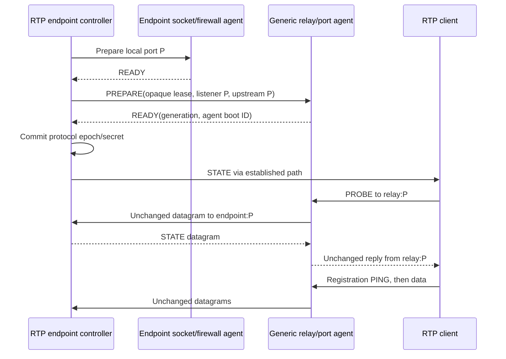

# Generic UDP relay

Status: static standalone tool implemented as `cpxy-udp-relay` in the
`udp-relay/` workspace crate; dynamic management below remains proposed. It forwards UDP datagrams between configured
listeners and upstreams. Its core has no RTP decoder, tunnel keys, TUN device,
VPN session state or transport-specific epochs.

The [RTP application plan](rtp-l3-application-plan.md) is one consumer. RTP-specific
port coordination belongs to that application's controller/adapter, not the relay.
The static implementation and local verification are documented in
[`udp-relay/README.md`](../udp-relay/README.md). No public deployment is claimed.

## Static mappings and forwarding

A mapping contains an identifier, listen address/port, configured upstream
address/port, admission policy and resource limits. Generic mappings may translate
ports. Upstreams are explicitly configured/allowlisted by an administrator;
incoming packets cannot supply arbitrary forwarding destinations.

Payload-embedded addresses and negotiated ports are never rewritten. Protocols
that advertise additional endpoints need explicit mappings or their own external
controller; opaque forwarding alone does not supply protocol translation.

```text
flow key = (mapping ID, lease generation, listener address/port,
            observed client source address/port)

client tuple -> relay listener A -> dedicated connected UDP socket -> upstream B
client tuple <- relay listener A <- that same dedicated socket    <- upstream B
```

One connected upstream socket per flow supplies unambiguous response routing.
Always send the response from listener `A`. One shared upstream socket per
listener cannot generally associate replies with clients without understanding
the payload. Rebinding creates a new flow; an old flow's replies must never be
redirected to the new tuple. Multiple mappings/upstreams have independent state.

Preserve datagram boundaries and payload bytes. Treat zero-length datagrams
correctly and reject/drop truncated or oversized input with counters; do not
silently split datagrams. Payload limits are configurable and protocol agnostic.
There is no user-space retransmission protocol, TCP wrapper, packet aggregation,
payload-derived destination, or interpretation of SSRC/sequence fields.

No relay TUN, kernel DNAT or host IP forwarding is required. Listen/upstream bind
addresses, routing and DNS resolution policy are explicit configuration. Pin a
resolved upstream for a flow; changing its destination requires a new generation
and drain/reconnect policy rather than silently redirecting existing clients.

## Resources and operations

- Require global/per-mapping/per-source flow, byte/packet-rate, descriptor and
  buffer budgets. Clients behind one CGNAT address share source-IP quotas;
  source IP is not an authenticated user identity.
- Use small bounded socket buffers and bounded work per poll; never multiply an
  endpoint-sized multi-megabyte buffer or unbounded queue by every flow.
- Update idle time on either direction. The operator/application chooses expiry
  for its protocol; do not bake a VPN-specific lifetime into the generic tool.
- Connected upstream sockets filter responses by the configured peer. Surface
  ICMP/send errors, overflow, rejection, expiry and allocation failures in counters.
- A process restart discards flow state. Whether a protocol can recover through
  a recreated flow is its application's responsibility; the relay does not
  synthesize a registration or client identity.
- Metrics expose mapping/lease IDs, flow counts, traffic, drops and health.
  Endpoint details are private diagnostics; keys/payloads are never logged by
  default. No claim is made about encryption/authentication of opaque traffic.

Static mapping configuration and graceful shutdown are the first delivery.
Support local administrator-managed firewall admission as well as an injected
port-admission provider; avoid an RTP dependency in either path. The
[firewalld design](rtp-l3-firewalld-design.md) describes the shared host-side lease
contract and ownership rules.

## Optional dynamic listener management

An authenticated administrative interface can prepare, retain and retire mappings.
It is optional for static use. Requests contain opaque owner/lease IDs, generation,
listener/upstream specification and deadlines. The relay validates them against
its configured authority and allocation pools. Repeated requests are idempotent
only while the corresponding resources still exist. Acknowledgements include
agent boot identity; stale acknowledgements do not establish readiness.

The generic interface does not carry VPN PSKs, port secrets or RTP messages.
An RTP controller may encode its own endpoint/epoch identity in an opaque lease
ID, but the relay does not parse it. Initial networked management uses mutual
TLS with credentials separate from application transport keys. Packet sources
cannot invoke this interface or request firewall openings.

PREPARE binds the listener, establishes forwarding/admission and returns READY.
A prepared listener can already forward when acknowledged. Staged deadlines
reap abandoned preparation. Committed management leases have an explicit outage
grace; expiry releases resources and reports degraded/failure status. Retire
stops new flows, drains/closes that generation and releases its admission.
Late retirement for generation N must not close generation N+1. Reconcile local
inventory after restart before reporting ready.

## RTP integration constraints

These rules apply to the RTP adapter, not other relay users:

1. Preserve the numeric base and rotation ports across both hops. Encrypted
   STATE names a port on the client-configured relay IP; the relay cannot rewrite
   it. Generic port translation is supported by the tool but is unsuitable for
   this initial RTP adapter without protocol changes.
2. Each RTP profile pins one endpoint. Several endpoint profiles use distinct
   listener IPs or nonoverlapping pools. Do not balance packets of one tunnel
   across endpoint instances. Services behind an endpoint use its L3 routes.
3. Forward every datagram, including base fallback data. No control/data
   classification or SSRC-based client identity is available to the relay.
4. Choose a flow expiry exceeding the endpoint's 90-second session expiry and
   maximum control cadence; 180 seconds is the adapter's initial proposal.
5. The endpoint sees a relay upstream tuple for each client path. Existing
   authenticated PING, PROBE validation and same-port repair learn/recover those
   tuples. The relay never needs the client's inner IP or key.
6. Both demonstration data hops use public IPv4. Management may use a separate
   SSH/overlay path; it must not become implicit data forwarding.



The RTP controller waits for local and relay readiness before STATE, including
base plus the selected initial non-base port at startup. If preparation fails,
abort that generation and keep the current epoch/path. There is no distributed
atomic commit: a crash after READY remains possible, so client validation and
base recovery stay necessary.

Control-plane loss freezes new rotations and retains committed paths within
their configured outage grace. Retire under the endpoint's existing grace and
oldest-port bounds; require both hosts to release an old generation before
reusing its numeric port. Only live/staged leases are admitted, not the whole
allocation pool. Backend UDP admission may be restricted to the relay's configured
egress addresses without restricting its ephemeral source ports.

## Completion checks

Generic tests use arbitrary UDP echo/payload fixtures: two clients, two mappings,
port translation, exact bytes/boundaries, return source ports, zero-length and
oversized input, quotas, expiry and restart. They do not require RTP keys or a
TUN. Management tests cover stale generations, conflicts and failed admission.

Then test the RTP adapter with base plus a fixed initial rotation port, followed
by coordinated rotation. Inject failed firewall operations, delayed/replayed
acknowledgements and management loss. One scoped three-node public application
demonstration proves the new integration; it does not reopen the retired PoC
network-testing campaign.
